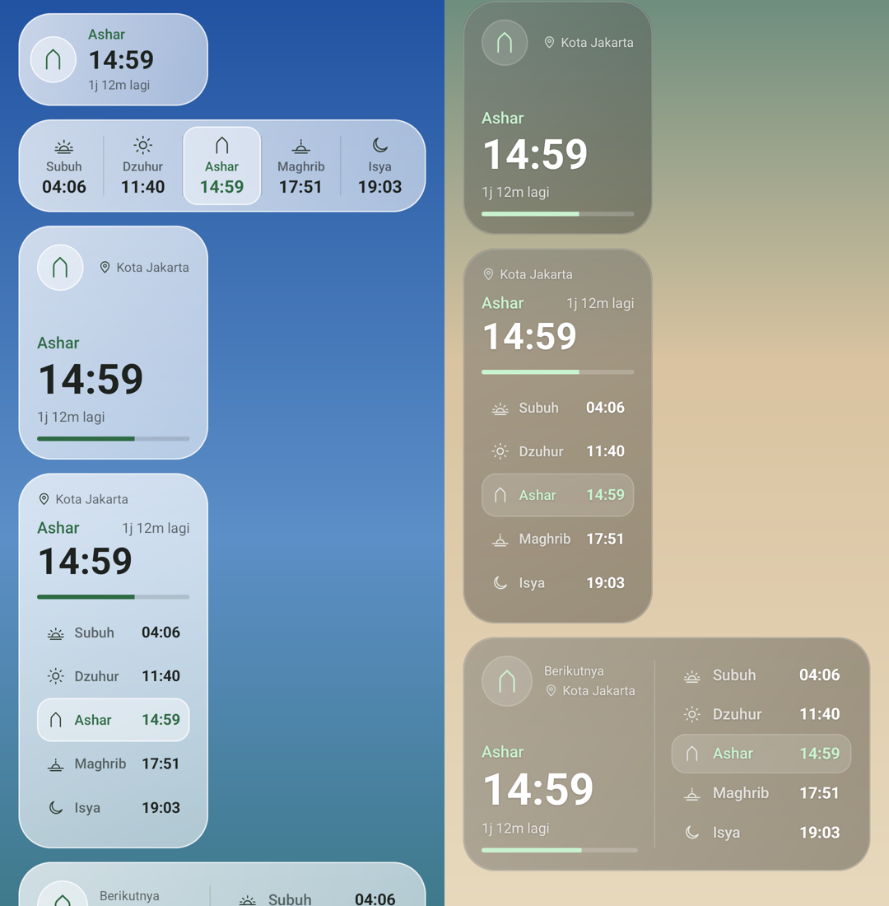
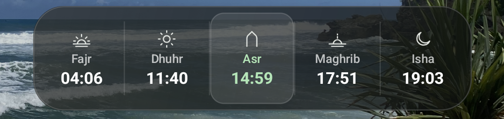

# Jadwal Shalat Widget

Minimal glassmorphism home-screen widgets for Indonesian prayer times (Fajr → Isha), powered by the
[EQuran.id prayer schedule API](https://equran.id/apidev/shalat).





## Download

**[⬇ jadwal-shalat.apk](https://github.com/kitsuneeesan/jadwal-shalat-widget/raw/main/release/jadwal-shalat.apk)** (Android 8.0+)

Open the file on your phone and allow "Install unknown apps" when asked. The APK is a debug-signed build.

## Features

- **Responsive:** one widget whose layout changes as you resize it (Android 12+).

  | Size | Shows |
  |---|---|
  | 2x1 | Next prayer at a glance |
  | 3x1 / 4x1 | Full schedule row |
  | 2x2 | Next prayer, time left, progress |
  | 2x3+ | Next prayer + schedule list |
  | 3x2 / 4x2+ | Card: next prayer with progress, plus the full schedule |
- **Light/dark glass:** the style follows the phone's theme automatically.
- **Automatic location:** the regency/city is detected from the phone's location and matched to the API's list. You can also pick it manually.
- **Live countdown** to the next prayer, updated every minute.
- **Tap to refresh**: tapping the widget reloads the schedule and re-detects the location.
- **Language follows the phone**: English, or Indonesian when the phone is set to Indonesian.
- **No launcher icon**: settings open when you add the widget, and later from long-press → Settings.

## Usage

1. Install the APK.
2. Long-press the home screen → **Widgets** → **Prayer Times**, then pick a size.
3. In the settings screen that opens, allow location (or turn off *Automatic location* and choose your province/city), then tap **Done**.

Optional, both found in the widget settings:

- **Allow countdown to update every minute**: grants exact alarms, so the countdown doesn't lag by up to a minute.
- **Follow location while app is closed**: grants background location, so the widget can follow you when you travel.

## Build

Requires JDK 17 and the Android SDK (platform 36).

```sh
./gradlew testDebugUnitTest assembleDebug
adb install -r app/build/outputs/apk/debug/app-debug.apk
```

The widget layouts are generated; edit `tools/gen_widgets.py` and run:

```sh
python3 tools/gen_widgets.py
```

Colours live in `app/src/main/res/values/colors.xml` (light) and `values-night/colors.xml` (dark).
Debug builds include a preview screen of every layout:

```sh
adb shell am start -n com.rizki.jadwalshalat/.PreviewActivity
```

## Notes

- The schedule is fetched once per month and cached on the phone.
- The countdown to Fajr after Isha on the last day of a month uses that day's Fajr time, so it can be off by about a minute.
