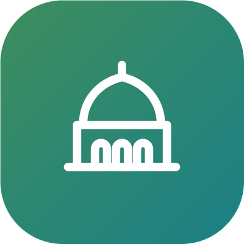
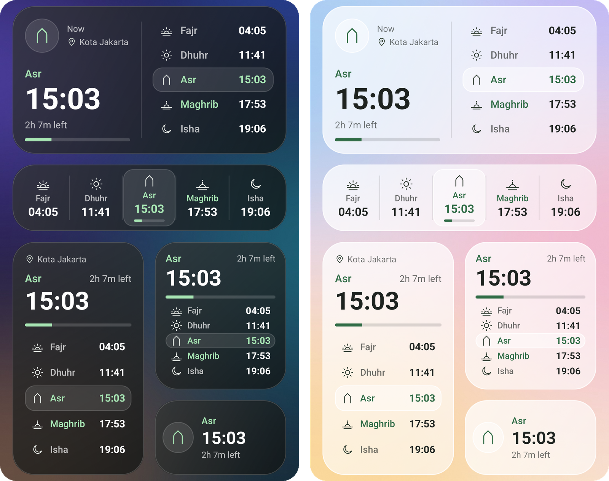
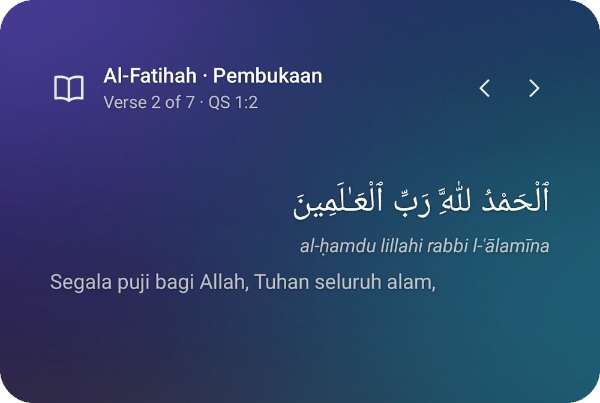
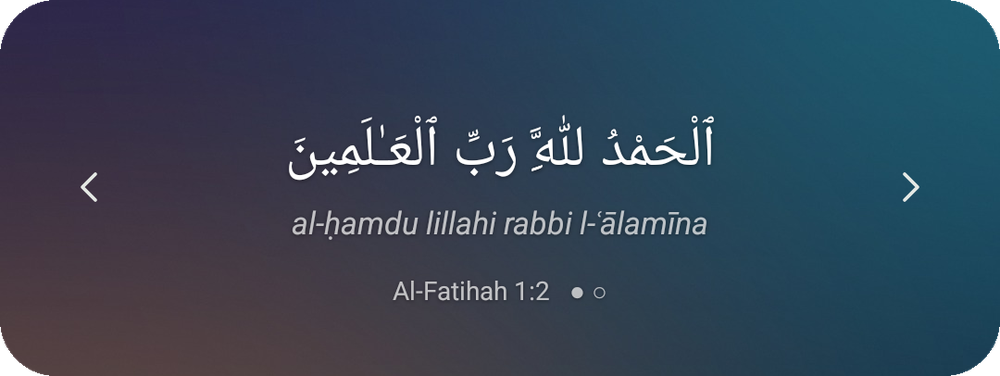

<div align="center">

<br/>
<br/>



# Jadwal Shalat

### Glassmorphism Prayer Times & Quran Widgets for Android

<br/>

[](https://github.com/kitsuneeesan/jadwal-shalat-widget/raw/main/release/jadwal-shalat.apk)
[](#download)
[](#build)
[](https://equran.id/apidev/shalat)
[](https://api-docs.quran.com)

<br/>

[**Download**](#download) · [**Features**](#features) · [**Usage**](#usage) · [**Build**](#build) · [**Disclaimer**](#disclaimer)

</div>

> [!IMPORTANT]
> Prayer times come from the public [EQuran.id](https://equran.id/apidev/shalat) API and cover regencies/cities in Indonesia only. Quran text, transliteration and the Indonesian translation (Kementerian Agama) come from [quran.com](https://quran.com). This project is not affiliated with either.

---

<div align="center">



<h1><a id="features"></a>Features</h1>

<table>
  <tr>
    <td width="50%" valign="top">

#### Prayer Times
- **One widget, every size.** It rearranges itself as you resize it, from a 2x1 glance up to a full 4x2 card. The 2x2 shows the running prayer plus all five times.
- **Focus on the prayer happening now.** The running prayer is highlighted with time left until its end. Fajr ends at sunrise, Isha at the next Fajr.
- **Deadline bar** that shifts from green to amber to red as the prayer's time runs out.
- **Next prayer at a glance** in the schedule list.
- **Tap to refresh.** Tapping reloads the schedule and re-detects your location without opening anything.
- **Lock screen (Samsung One UI).** A 2x1 prayer widget you can add to the lock screen.

    </td>
    <td width="50%" valign="top">

#### Quran Verse
- **A verse a day,** from Al-Fatihah 1:1 to An-Nas 114:6, then from the start again.
- **Arabic with its transliteration right underneath,** line by line, then the translation.
- **Long verses come in pages.** Tap the verse for the next page. ‹ › switch verses.
- **4x2 and 4x1,** switching layout as you resize. The Quran widgets are transparent and monochrome.
- **Works offline.** Each surah is saved on the phone after its first download. You can save all 114 at once from the widget settings.

#### Look & Feel
- **Frosted glass** that follows the system theme: milky glass in light mode, smoky glass in dark mode.
- **Speaks your language.** English, or Indonesian when the phone is set to Indonesian.
- **No app icon clutter.** Settings live behind the widget (long-press → Settings).
- **Automatic location** from the phone, matched to the API's regency/city list. A manual picker is available too.

    </td>
  </tr>
</table>

<table>
  <tr>
    <td width="50%" align="center" valign="middle">
      <br/>
      <sub>Quran Verse · 4x2</sub>
    </td>
    <td width="50%" align="center" valign="middle">
      <br/>
      <sub>Quran Verse · Row · 4x1</sub>
    </td>
  </tr>
</table>

</div>

---

<div align="center">

<h1><a id="download"></a>Download</h1>

<a href="https://github.com/kitsuneeesan/jadwal-shalat-widget/raw/main/release/jadwal-shalat.apk"></a>

Grab [`release/jadwal-shalat.apk`](https://github.com/kitsuneeesan/jadwal-shalat-widget/raw/main/release/jadwal-shalat.apk) (Android 8.0+).
Sideloading requires enabling "Install unknown apps" for whichever app you open it with.

</div>

---

<div align="center">

<h1><a id="usage"></a>Usage</h1>

</div>

1. Install the APK.
2. Long-press the home screen → **Widgets** → **Prayer Times**, then pick a widget (you can resize it later):

   | Widget | Starts at | Shows |
   |---|---|---|
   | Prayer Times | 4x2 | The running prayer plus the full schedule |
   | Prayer Times · Row | 4x1 | The five times in a row |
   | Next Prayer | 2x2 | The running prayer plus all five times |
   | Quran Verse | 4x2 | Today's verse |
   | Quran Verse · Row | 4x1 | Today's verse, one line at a time |
3. In the settings screen that opens, allow location (or turn off *Automatic location* and pick your province/city), then tap **Done**.

**Lock screen (Samsung):** long-press the lock screen → **Edit** → **Widgets** → **Prayer Times**.

Optional extras in the widget's settings:

| Option | Why |
|---|---|
| **Allow countdown to update every minute** | Grants exact alarms, so the countdown never lags behind the clock. |
| **Follow location while app is closed** | Grants background location, so the widget can follow you while you travel. |
| **Save all surahs offline** | Downloads the whole Quran, so the verse widget never needs a connection. |

---

<div align="center">

<h1><a id="build"></a>Build</h1>

</div>

Requires JDK 17 and the Android SDK (platform 36). The app has no third-party dependencies.

```sh
./gradlew testDebugUnitTest assembleDebug
adb install -r app/build/outputs/apk/debug/app-debug.apk
```

Widget layouts are generated from `tools/gen_widgets.py`; edit it and run `python3 tools/gen_widgets.py`.
Colours live in `res/values/colors.xml` (light) and `res/values-night/colors.xml` (dark).

Samsung's lock screen only lists widgets that declare Samsung's own attributes (`targetHost`, `widgetSize`, `widgetStyle`). They are declared in `res/values/attrs.xml` and used in `res/xml/prayer_lock_info.xml`.

Debug builds include two extra screens:

```sh
adb shell am start -n com.kitsuneeesan.jadwalshalat/.PreviewActivity                      # every layout
adb shell am start -n com.kitsuneeesan.jadwalshalat/.ShowcaseActivity --es scene night    # screenshots (night | day | logo | quran)
```

---

<div align="center">

<h1><a id="disclaimer"></a>Disclaimer</h1>

</div>

- **Check with your local mosque.** Times are as published by the API. Some regions follow different conventions.
- **Privacy:** your location is only used to work out your regency/city name, through Android's Geocoder (which may use an online service). The app only sends the province/city name to EQuran.id; the Quran widget only downloads surahs from quran.com.
- **APK signing:** the APK is a debug-signed build.
